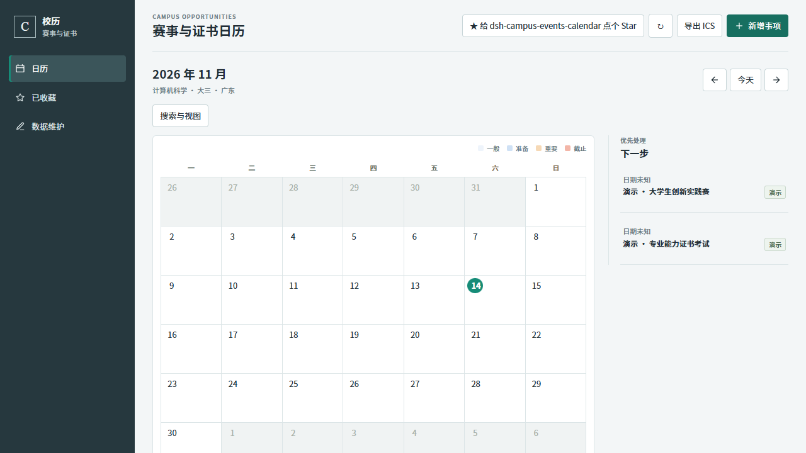

# DSH 大学生赛事与证书日历

[](https://github.com/Vertingod/dsh-campus-events-calendar/stargazers)
[](https://awesome-dsh-plugin.com/p/Vertingod/dsh-campus-events-calendar/)



提供本地维护的赛事、证书考试与关键日期日历。插件通过 DSH 侧栏「赛事日历」入口打开，桌面默认月历优先，支持列表、收藏和数据维护。

> 用着顺手的话，顺手点个 Star 支持一下：https://github.com/Vertingod/dsh-campus-events-calendar
> 插件内的「★ 点个 Star」按钮和这条 README 指向同一个仓库地址。

## 安装与运行

需要 Node.js 20+ 与 DeepSeek Harness 0.2.x。用 DSH 插件管理器从本地包目录安装 `dsh-campus-events-calendar` 后，在插件页启用；桌面端若插件管理器要求重启，按其提示重启 DSH。源码开发命令：

```powershell
npm install
npm test
npm run build
npm run preview
```

`npm run build` 生成 DSH module-loader client bundle `dist/client.js` 与 CSS。插件 host API 使用 `/campus-calendar` 前缀。

改插件前先读 [docs/dsh-plugin-development.md](docs/dsh-plugin-development.md)：里面固化了 `cordis.patch.yml`、host/client 半片、`defineTool` schema（属性级 `required` 必须提升为数组）、`ctx.effect` 生命周期与 esbuild 打包的踩坑点。

验证与预览命令（均为本地、离线）：

```powershell
node --test test/*.test.js   # 全部 41 项领域、宿主、客户端、CSS 与性能正确性测试
node --test test/performance.test.js # 1,000 条记录、100 次采样并打印 p50/p95（仅作环境观察，不设 CI 时间门槛）
node scripts/preview.mjs     # 构建 .preview/ 预览包（使用真实 client bundle）
node scripts/preview-server.mjs  # 本地预览：http://127.0.0.1:4178/
```

`test/client.test.js` 挂载打包产物，覆盖侧栏、可信度、筛选/搜索、收藏/提醒、编辑器校验、草稿保留、刷新竞态、忙碌与成功反馈、读取失败恢复；`test/layout.test.js` 校验桌面两栏、窄屏堆叠、主题 token 与 reduced motion。浏览器实测视口：1280×800 和 390×844，`documentElement.scrollWidth` 均等于视口宽度。性能基准在 Node.js 本地以 1,000 条记录采样 100 次；实际 p50/p95 记录于本次开发进度文件。

## 用对话生成一份自己的日历

主路径是**生成**，不是一条条登记。界面顶部的卡片「让 Agent 生成属于我的日历」有三个按钮，点任意一个都会开一个新对话、把草稿填进输入框（**不直接发送**，你补完再发）：

| 按钮 | 草稿形态 | 适合 |
| --- | --- | --- |
| 开始生成我的日历 | 先问专业 / 年级 / 地区 / 关注方向 / 今年目标，再挑 6-10 项写进日历 | 首次使用、换学期、想重做一份 |
| 按学期排一批 | 给出时间范围 + 已有档案 | 期末、开学前集中铺一批关键节点 |
| 记一个已定的 | `/campus-calendar-add` + 事项 / 时间 / 链接空档 | 已经确定的一件事，直接记 |

「开始生成」的草稿写明了执行顺序：**先问 → 用 `campus_calendar_set_profile` 存档案 → 再挑事项用 `campus_calendar_add_item` 逐条写入 → 回报每项的时间精度（到日 / 到月 / 到年 / 待确认）**。挑出来的事项会带上 `majors` / `years` / `regions` / `interests`，日历的「只看适合我」和适配度才有依据。

草稿由 host 端的 `GET /campus-calendar/draft?kind=plan\|semester\|add\|ask` 生成，带当天日期和精度阶梯约束：不确定就用更粗的精度记（到月 / 到年 + `predicted` + 依据），不许编造精确日，也不许因为不确定就把时间留空；档案里已有的字段会带进草稿，避免重复问。

点按钮时客户端调用宿主 `uiWorkspace.startSession(undefined, { prompt, whenDraftExists: 'replace' })` 开新对话；宿主没有这个服务时按钮会给出可读提示，不会静默失败。

### 自带 skill `campus-calendar-add`

插件通过 `ctx.skills.registerProvider` 注册一个随包 skill（`skills/campus-calendar-add.md`），模型在用户提「生成我的日历 / 赛事日历 / 记到日历」时能命中，也可显式 `/campus-calendar-add` 调用。它写明了档案与事项的分工、挑选原则（宁少勿滥、不拿泛泛比赛凑数），以及日期硬规则：**精度阶梯**（`exact` / `range` / `month` / `year`）与可信度（`official_confirmed` / `predicted` / `pending_confirmation` / `unknown`）分开记录；每个事项至少要有一个时间锚点，模糊时间用更粗的精度 + `predicted` + 依据，只有完全没提时间才留 `null`；`official_confirmed` 仍需「具体日期 + http(s) 来源 + 核验日期」齐备。

### 写入工具

- `campus_calendar_set_profile`：写入学业档案（`major` / `year` / `province` / `interests[]` / `types[]`）。只写用户亲口说过的字段：没传的保持原值，空值不会清掉已有档案。这是判断「适不适合我」的前提。
- `campus_calendar_add_item`：新增**单个**结构化事项。例如：“把下周校赛报名截止记到日历”。调用方（DSH agent）负责把话语解析为工具参数；插件不接收自由文本、不解析日期表达、不调用模型，也不抓取或访问来源 URL。写入复用本地校验和串行追加逻辑，成功后只保存在本机数据文件中。

日期不明确时不要留空，而是降精度：知道一段窗口用 `range`，只知道月份写该月 1 日 + `accuracy: "month"`，只知道年份/学期写该年 1 月 1 日 + `accuracy: "year"`，并配 `predicted`、在 `note` 里写清依据。只有完全没有任何时间线索才留 `null` + `unknown`。展示层会按精度说话（「3 月（预计）」而不是编出来的「3 月 1 日」）；`official_confirmed` 仅接受具体日期、HTTP(S) 来源 URL 与最近核验日期，URL 只作为记录保存，插件不会替用户访问或核验。工具拒绝多事项数组、无效 payload 和不满足可信度规则的数据；它不会执行删除、覆盖或联网操作。

## 数据可信度与隐私

默认示例只标记为“演示数据”，时间窗是未来几个月的「月份精度」演示（`accuracy: "month"` + `predicted` + note 说明非真实安排），首屏能看到粗粒度日期如何呈现。没有官方数据 API、自动抓取、自动核验、云端同步或 OS 通知。提醒仅保存为插件内偏好，不会发系统通知。

真实事项录入官方确认节点时，必须填写 `https:`/`http:` 来源 URL 和最近核验日期；预测日期必须说明依据。待确认与预测日期会显式标注；只到月/年的窗口在月历里按整月长条显示（年份精度不进月历格，避免糊掉真实日期），跨多天的窗口只在起点和「今天」出标题、其余格子留一条连续色条，导出 ICS 时标题带「（月份待定）」/「（年份待定）」。完全没有时间锚点的事项不进入月历格，日历页顶部会提示「还有 N 项没有时间锚点 / 已锚定 P%」并给出补录入口。所有记录存于 `$DSH_HOME/campus-events-calendar/state.json`，未设置 `DSH_HOME` 时为 `~/.dsh/campus-events-calendar/state.json`。

JSON 导入要求 schema version `1`，包含 profile/items；favorites/reminders 可选。导入文件最大 2 MB，结构错误会拒绝且不覆盖原数据。建议导入前导出 JSON 备份。

## 发布与推广

本仓库自带一套可复用的发布工具层（`tools/release/`），任何 dsh 插件把该目录连同 `docs/RELEASE.md` 拷过去即可复用：

| 命令 | 作用 |
| --- | --- |
| `npm run release:check` | 发布前自检（dsh.bundle、仓库字段、图标、client 产物、screenshots.json、密钥扫描） |
| `npm run release:entry` | 生成提交给 awesome-dsh-plugin 目录的条目 YAML（`market/<owner>__<repo>.yml`） |
| `npm run release:star` | 生成插件内 Star 引导入口 `src/star-entry.js` |
| `npm run release:pack` | `npm pack` + 安装冒烟，确认随包产物齐全 |

完整六阶段流程（建仓推送 → 配图 → 市场收录 PR → Star 引导 → 发版推广 → 版本迭代）见 [docs/RELEASE.md](docs/RELEASE.md)。
